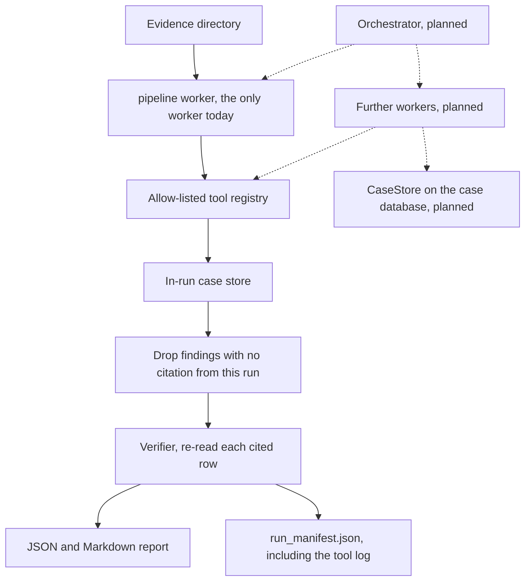

# auto-forensics

[](https://github.com/GameMaster007/auto-forensics/actions/workflows/ci.yml)

**AI drafts, the analyst verifies, everything is cited.**

auto-forensics is a local triage draft for people learning digital
forensics and for a junior analyst who has to explain a case. It reads
a directory of evidence, drafts findings, and keeps a finding only when
it points at an artifact from that directory: the artifact id, the
source file, a row or a byte offset, and the SHA-256. A finding
without that pointer is dropped. The draft is labelled
`analyst-unverified` until a person accepts or rejects it. That review
step is stored as a field and is not implemented yet.

Maintained by [Benjamin Christy](https://github.com/GameMaster007).

This is not a claim that a model does forensics. Plaso, Hayabusa, and
Chainsaw remain the right tools for parsing. This repository does not
image disks, collect endpoints, or train its own model. Importing
those tools' output is on the [roadmap](docs/ROADMAP.md) and is not in
this version.

## Why it is worth studying

A DFIR or SOC lab spends most of its time on the gap between a log line
and a sentence in a report. Students are asked to show which row they
relied on. A model that writes a confident paragraph without that row
teaches the wrong habit. The code in this repository is small enough
to defend in a viva:

- parsers record the file hash and the row they read
- the model sees evidence only as quoted data, not as instructions
- a finding survives only when its citation matches a hash from this run
- the run writes a manifest of inputs, the tool log, and the report hash

## Install

Python 3.10 or newer. The core install has no third-party packages.
Optional extras cover PE files, EVTX, packet captures, YARA, Sigma,
SQLAlchemy, and the API server.

```bash
python3 -m venv .venv
source .venv/bin/activate
python -m pip install -e ".[dev]"
```

Windows PowerShell:

```powershell
python -m venv .venv
.venv\Scripts\Activate.ps1
python -m pip install -e ".[dev]"
```

The command `auto-forensics` is installed by that editable install.

## Quickstart

The fixture in `examples/case1` is synthetic. The names, the host, and
the address `203.0.113.19` are made up. Do not replace it with a real
case.

```bash
auto-forensics run \
  --case-id demo-synthetic \
  --input-dir examples/case1/artifacts \
  --output-dir output/demo-synthetic \
  --llm mock
```

`--llm mock` does not call a network and does not need an API key. It
writes `case_report.md` and `run_manifest.json` under the output
directory. Replay checks that a second run still matches:

```bash
auto-forensics replay output/demo-synthetic/run_manifest.json
```

A match prints `"match": true` and exits 0. A changed input file, or a
report hash that does not match the manifest, exits 1. The hash omits
`generated_at`, so the clock in the report does not cause a mismatch.
Seed is 0. The mock does not sample, so its temperature stays null.

`--llm off` uses the same citation rule with a score-based heuristic
and no draft wording from the mock. `--llm ollama` calls a local
Ollama-compatible endpoint at temperature 0. If that endpoint is down,
the binary draft falls back to the heuristic. Do not point it at a
hosted model with real case data unless you are allowed to.

The managed case commands (`init`, `ingest`, `analyze`) copy evidence
into a case directory and refuse a source outside
`AUTO_FORENSICS_ALLOWED_INGEST_ROOTS`. That list defaults to your home
directory, so a clone outside your home will be rejected until you set
it. `run` reads the directory you pass and does not use that list.

```bash
export AUTO_FORENSICS_HOME="$PWD/.auto_forensics"
export AUTO_FORENSICS_ALLOWED_INGEST_ROOTS="$PWD"
auto-forensics init --case-id demo-synthetic
auto-forensics ingest --case-id demo-synthetic --source-dir examples/case1/artifacts
auto-forensics analyze --case-id demo-synthetic --llm mock
```

## Example output

This is the findings section from `auto-forensics run --llm mock` on
`examples/case1/artifacts`. The citations below are hashes of the files
in the repository. `generated_at` is still written on the report and is
left out of the manifest's report hash.

```text
## Findings
- [MEDIUM] Draft triage: binary risk signal needs analyst review (0.39)
  - Evidence: suspicious_score=1.75; LLM-generated draft. Analyst verification required.; cmd.exe
  - Recommendation: Open the cited file and confirm the claim before acting on it.
  - Status: worker pipeline; LLM-generated, analyst-unverified
  - Verification: supported
  - Citation: `bin-e5961e7b20c14b3a` `sample_loader.bin` offset 0 `e5961e7b20c14b3a89f9a553bd77a199cb8750689692f6b0299be934aca9705b`
- [MEDIUM] Sysmon process execution signal (0.72)
  - Evidence: unknown executable launched from temp directory; source=sysmon
  - Recommendation: Open the cited artifact and confirm the signal before acting.
  - Status: worker pipeline; detector, analyst-unverified
  - Verification: supported
  - Citation: `evt-1001` `events.json` row 1 `7091b7a90f5e452f1d81f9ed211a2526d7d46fcd33451c28d44b3fe4370273c8`

## Verifier
- supported: `fdg-mock-e5961e7b20` (mock) cited row contains every claim sentence
- supported: `plg-eda4f0bb58a4` (mock) cited row contains every claim sentence
```

The binary citation is offset 0. That means "this file". The pipeline
does not yet point at the matching string inside the file. The JSON
event citation is record 1 of `events.json`.

The manifest for that run lists one worker, `pipeline`, and the tools
it was allowed to call, including `verify_findings`. `limits.verifier`
is `rules+mock`. `limits.replay` is `available`. `limits.orchestrator`
is `not-run`. The binary draft quotes `cmd.exe` because that string
is in `sample_loader.bin` and the verifier requires a claim sentence
to occur in the cited file.

## Architecture



Solid boxes are what a run does now. Dashed boxes are planned and are
not called.

Today one worker, named `pipeline`, runs inside `run_case`. It may
call only the tools registered for that run. Each call is appended to
`MemoryCaseStore` and copied into the manifest. A name that is not on
the list is refused and still logged. Findings are submitted with
`add_findings`, which sets `Finding.worker`. A model cannot pick that
name.

`PluginRegistry` loads parsers and detectors. It is not the tool
allow-list. `DatabaseBackend` is the SQLite or SQLAlchemy case
database used by `init` and `analyze`. `run_case` does not open it.
The service writes the finished report into that database afterwards.
A later `CaseStore` on top of `DatabaseBackend` is how more than one
worker would share a durable case. That adapter is not written.

More detail is in `ARCHITECTURE.md` and `docs/ROADMAP.md`.

## What a citation is

| Field | Meaning |
| --- | --- |
| `artifact_id` | Id from the record, or a stable id derived from the file hash |
| `source_file` | File the parser read |
| `row` | 1-based record index for JSON, or 1-based file line for CSV and text |
| `offset` | Byte offset. Binary findings use 0, meaning the whole file |
| `sha256` | Hash of the source file |

The citation check confirms that this run ingested that id and hash.
The verifier then opens the file again. A claim sentence that is not
in the cited row is dropped, and the manifest records a rejected
verdict. The check is "the words are in the row". It does not decide
whether those words are a fair conclusion.

## Offline model and Ollama

| `--llm` | Behaviour |
| --- | --- |
| `mock` | Fixed draft wording. No socket. Used by the demo and the tests. The verifier's judge is the offline mock. |
| `off` | Heuristic score only, still cited. The verifier uses rules only. |
| `ollama` | Local endpoint, temperature 0, seed 0. `--llama-endpoint` defaults to `http://localhost:11434`. The verifier may ask that endpoint to judge a claim the rules already accepted. |

`--disable-llama` is the older spelling of `--llm off`.

An OpenAI-compatible endpoint is used only when
`AUTO_FORENSICS_OPENAI_ENDPOINT` is set and you did not pass `--llm`.
Leave it unset for the demo.

## Plaso, Hayabusa, and Chainsaw

This tool does not run those programs and it does not collect evidence.
Drop an export they already wrote into the input directory. The
synthetic files in `examples/timeline-imports/` are small and contain
no real case:

| File | Export |
| --- | --- |
| `plaso-psort.csv` | Plaso `psort` l2tcsv. Seventeen fixed columns. `date` is `MM/DD/YYYY`. |
| `plaso-psort.jsonl` | Plaso `psort -o json_line`. One event per line. |
| `hayabusa.csv` | Hayabusa CSV timeline. The header includes `RuleTitle` and `EventID`. |
| `hayabusa.jsonl` | Hayabusa JSONL timeline. One detection per line. |
| `chainsaw.json` | Chainsaw `--json`. A JSON array of detection objects. |

```bash
auto-forensics run --llm mock --case-id timeline-imports \
  --input-dir examples/timeline-imports \
  --output-dir output/timeline-imports
```

`--llm mock` makes no network call and needs no API key. Each kept
finding cites the export's SHA-256 and the row: line 2 of a CSV is the
first record, a JSONL row is that line's number, and a JSON array row
is the 1-based object index. Hayabusa and Chainsaw rows are detections,
so each rule name becomes a claim. A Plaso row becomes a claim only
when the export already tagged it (`tag` in JSONL, or `notes` starting
with `tag:` in l2tcsv). Other Plaso rows stay on the timeline.

The field text is untrusted evidence. The recommendation is fixed
wording from this program. When a row is sent to a model, it sits
inside the `<<<EVIDENCE_DATA` fence with the rest of the case. A
sentence in the export does not become an instruction.

## Limitations

- The verifier checks that each claim sentence occurs in the cited
  row. A planted sentence that is not in the row is dropped. A false
  sentence that repeats the row is kept. A mock or heuristic draft
  with no claim sentence is kept and labeled score-based when the
  file hash matches. A live model draft with no claim sentence stays
  in the report as needs review.
- Sigma keyword matches are dropped, because they do not cite a row.
- YARA matches cite the file at offset 0 when rules and `yara-python`
  are installed. A YARA finding with no claim sentence is kept when
  the file hash matches, because the finding is a detector label.
- There is no analyst accept or reject command. Every finding is
  `analyst-unverified`. `verification: supported` is the verifier.
- Replay compares input hashes and the canonical report hash. It does
  not compare the raw report file, because that file contains
  `generated_at`.
- The mock is not a model. It drafts one sentence when a binary's
  score is above zero, and it quotes one suspicious string from that
  file so the verifier has a sentence to check.
- The parsers read Plaso, Hayabusa, and Chainsaw exports. They do not
  run those programs, and they do not image a disk or collect logs.
- Only the `pipeline` worker runs. The interfaces for more workers are
  in the tree so they can be added later. Nothing schedules them.
- No precision, recall, or timing figure is published. None has been
  measured for this release.

## Ethics and legal use

Use this tool on evidence you are allowed to examine. The sample case
is fiction. Running it against a system, an account, or a person's
files without authority can be a criminal offence, including under the
Computer Misuse Act 1990 in the United Kingdom. This repository is not
legal advice, and a draft finding is not an expert conclusion.

Do not upload a real case to a hosted model. Prefer `--llm mock` or a
local Ollama process. Do not commit case data, tokens, or `.env` files.

## Development

```bash
ruff check src tests
python -m pytest -q
```

Continuous integration runs ruff, the test suite on Python 3.10, 3.11,
and 3.12, and a gitleaks scan.

## Layout

```text
src/auto_forensics/
  cli.py            command line
  pipeline.py       the pipeline worker
  citations.py      drop findings that do not match this run
  tools.py          allow-listed tool calls
  case_store.py     in-run store shared by workers
  workers.py        worker interface, no orchestrator
  manifest.py       run_manifest.json
  llama_workflow.py quoted prompts, Ollama, and the mock
  service.py        case database lifecycle
examples/case1/     synthetic fixture
docs/ROADMAP.md
tests/
```

## Licence

MIT. See `LICENSE`. The project metadata already named MIT before this
file was added. There was no other licence in the tree.

## Further reading

- [Contributing](CONTRIBUTING.md)
- [Security](SECURITY.md)
- [Code of conduct](CODE_OF_CONDUCT.md)
- [Changelog](CHANGELOG.md)
- [Roadmap](docs/ROADMAP.md)
